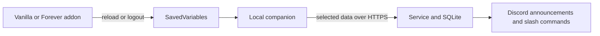

# WoW character status and Discord updates

A configurable WoW addon, local companion uploader, authenticated service and Discord
bot for friends sharing character progress across guilds.

**Two addon editions written; in-game validation pending.** At the owner's
request, no project dependencies were installed and no application or tests were
run on the work computer. Start with the [home testing guide](docs/HOME_TESTING.md).
Deployment uses isolated server services and GitHub checks; actual game validation remains a home task.

The default group flow is now **IDs entered directly in WoW**, one free-text ID
per line, with no Discord `/link` step. See [group setup and Discord mapping](docs/GROUPS.md).
The older linking commands remain available for legacy single-service installations.

## Included

- Two complete addon folders: `addon/vanilla/WoWStatus` and `addon/forever/WoWStatus`,
  with separate client adapters and metadata. See [edition setup](docs/ADDON_EDITIONS.md).
- Experimental in-game friend level popups through an explicitly selected, visible
  custom chat channel; off by default, trusted senders only, combat deferral.
- Scrollable in-game event history, export preview, level-versus-time line graph
  and per-level elapsed durations. Open with `/wstatus logs`, `graph`, or `times`.
- Previewed, explicitly confirmed one-time introduction when a character first
  joins the tracker, including existing characters installing the addon later.
- Level milestones, self-loot rarity filtering, equipment changes, optional death,
  last-known zone, addon-session updates and player-entered LFG messages.
- Selected profile fields: level, class, race, faction, guild, equipped gear/item
  links, last-known zone and requested playtime.
- Data-only SavedVariables parser, cross-platform uploader, local restart recovery,
  HTTPS enforcement and repeated-upload suppression.
- One-use Discord linking codes, per-installation credentials, ownership checks,
  SQLite state, privacy scrubbing and a persistent announcement outbox.
- `/character`, `/characters`, `/roster`, `/activity`, `/link`, `/nickname`, `/main`,
  `/settings` and `/privacy`, restricted to one
  configured Discord community. Commands respond privately to the requesting user.
- Discord names with optional nicknames, friend grouping, main/alt labels, combined
  daily reports, weekly adventures, community posting filters and an optional desktop uploader.
- One structured JSON file per character, grouped history and level-up times, explicit
  `Europe/Oslo` timestamps, and a daily recap at **00:05 Oslo time**.
- Linux/Windows checks and addon ZIP artifacts on GitHub, followed by isolated
  deployments for `ronkalot` and `navsquad`. See [server/pipeline setup](deploy/SERVER.md).

Addon settings are in **Options → AddOns → WoW Status**, with an account-wide
**Groups** subpage. `/wstatus` and `/wstatus groups` open those pages directly.
New characters start with sharing, profile fields, event collection and immediate
announcement checkboxes **on**; existing character choices are preserved.
The introduction still requires preview and confirmation. Groups and the optional
player name are shared across this WoW account; other choices remain per character. Export follows `/reload`
or logout. The companion uploads exported data; the service deduplicates and the
bot posts to the configured chat. This is delayed, last-known telemetry, not live
presence. The addon never sends HTTP or reads game memory.



Group-ID users enter their name in the addon and manage group privacy in the
companion. The Discord-name instructions below apply to optional linked installations.
See [decisions and tomorrow’s checks](decisions_i_made.md) for the settings-menu update.

See [friends, names and recaps](docs/FRIENDS_AND_RECAPS.md) for how your gang’s
characters stay together and how names are selected. No real name is needed in the addon.

See [in-game history and graph](docs/IN_GAME_HISTORY.md) for persistent logs,
partial level durations, Norwegian time and the graph’s data format.

See [live popup setup](docs/LIVE_POPUPS.md) for channel/trust commands and the
unverified Classic communication limits.

## Getting started at home

Python 3.11+ is required for the companion and service. The addon needs no Python
inside WoW. Each participating friend installs the addon and companion; only one
host runs the service and bot.

Follow [HOME_TESTING.md](docs/HOME_TESTING.md) for commands to install, validate the
pipeline without keys, install into the correct Classic Era client and then connect
Discord. The addon installer takes your client's actual interface version; the TOC
in the repository is a template and does not establish current-client compatibility.

No OpenAI key is required. All announcements use deterministic templates and no
character data is sent to OpenAI. Discord delivery stays disabled unless the service
is explicitly started with `--discord` and its environment variables are configured.

## Scope and remaining validation

Vanilla and Forever implementations are available in separate folders. The Forever
adapter is based on the available client API documentation. Both still need actual
in-game validation; see [compatibility status](docs/FOREVER_COMPATIBILITY.md).

Automatic dungeon/boss/completion attribution, group-run merging, quest chains,
attunements, talents, automatic profession skill tracking, mount/pet discovery, reputation, PvP,
recipe tracking, item allowlists, first-acquisition detection and digests remain
future milestones. They are not silently inferred from instance entry or inventory
baselines. See the [full plan](character-logs-plan.md) and
[implementation status](docs/IMPLEMENTATION_STATUS.md).

## Privacy and operations

Name, realm, client identifier and character GUID are required enrollment metadata;
other profile fields and event categories are independently selected. Loot events
can share an item even when the equipment profile is hidden. Historical Discord
posts are not removed automatically by changing settings or deleting service data.

Addon changes reach the server only after export and upload. For immediate server-side
pause/revocation, use `/privacy action:pause`. An already in-flight message may finish.
Deleting service data also revokes uploader credentials. Linking again requires consent;
it can introduce the character again after deletion.

Consented snapshot and event history is retained until deletion, with privacy
changes scrubbing related historical fields. Each character has its own structured
JSON archive; see [the JSON format](docs/JSON_FORMAT.md). Collection and immediate
announcement settings are separate, so non-milestone level-ups can be retained
without producing extra chat messages. Data is self-reported, not verified
Battle.net account ownership. Hosting, backups and operator access belong to your
private community. See [deployment and operator instructions](deploy/README.md).

## Development checks (run at home only)

```sh
python -m pip install -e ".[dev]"
python -m pytest
```

The suite includes a mocked Lua environment through Lupa. It cannot replace actual
WoW API checks. GitHub Actions runs checks remotely and produces both addon ZIPs. No tests run on the work computer.

Discord integration follows the [discord.py application-command example](https://github.com/Rapptz/discord.py/blob/master/examples/app_commands/basic.py)
and [interaction API documentation](https://discordpy.readthedocs.io/en/stable/interactions/api.html).

The Forever implementation is written; in-game compatibility is unverified. See [compatibility status and references](docs/FOREVER_COMPATIBILITY.md).
